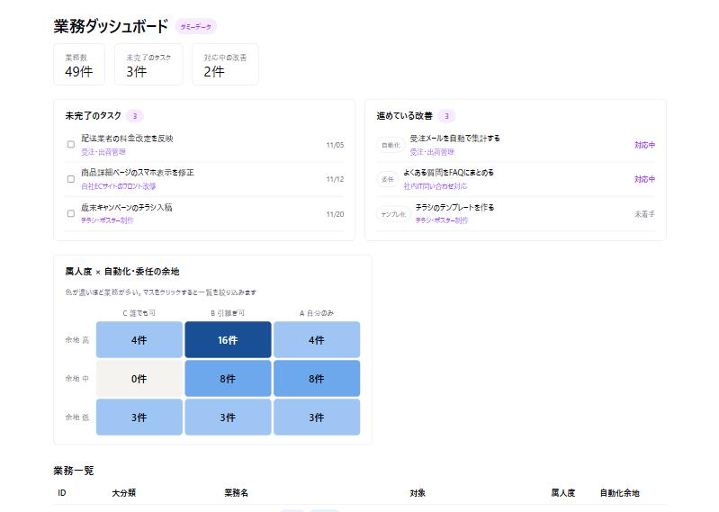
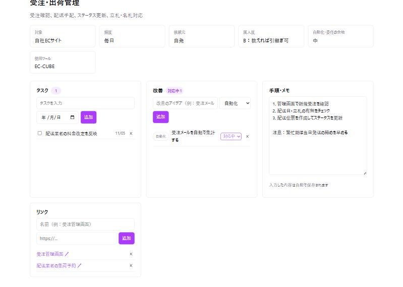

# 業務ダッシュボード

自分の業務を棚卸しして、**業務ごとにタスク・改善・手順・リンクを管理する**ためのダッシュボードです。
「どの業務から手を付けるか」を選び、その業務の効率化を積み上げていくことを目的にしています。

**公開デモ：** https://task-dashboard-phi-ochre.vercel.app/
（公開版は固有名詞を伏せたダミーデータです。入力したタスクなどは、見ている人のブラウザの中にだけ保存されます）



## できること

### ホーム
- **未完了のタスク**を全業務まとめて期限順に表示し、その場で完了にできる（期限切れは赤字）
- **進めている改善**（対応中・未着手）を一覧で確認できる
- **属人度 × 自動化・委任の余地のマトリクス**：49業務を3×3に分類し、マスをクリックすると業務一覧を絞り込む。
  「誰でもできる × 自動化余地が高い」業務など、手放しやすいところから着手できる
- 業務一覧には、未完了タスク・対応中の改善の件数バッジを表示

### 業務の詳細ページ（`/work/EC-01` など）



| 欄 | 内容 |
|---|---|
| タスク | その業務のToDo。期限を付けて追加・完了・削除 |
| 改善 | 改善アイデアを「自動化／委任／テンプレ化／やめる」で分類し、未着手→対応中→完了で進捗を管理 |
| 手順・メモ | やり方や注意点を書き残す。入力と同時に自動保存。属人化した業務を引き継げる形にする材料になる |
| リンク | 管理画面やスプレッドシートなど、その業務で使うURLをまとめる |

## 技術構成

| 用途 | 使ったもの |
|---|---|
| 画面 | React 19 ＋ Vite |
| ページの切り替え | React Router |
| データ保存 | ブラウザの localStorage（サーバー不要） |
| 業務データの変換 | Python（openpyxl）で Excel → JSON |
| 公開 | GitHub ＋ Vercel（push すると自動でビルド・公開） |
| 開発 | Claude Code と対話しながら、段階ごとに実装 |

## 工夫した点

### 実データを公開しない仕組み
元データは社内の業務棚卸し表（Excel）で、事業名や拠点名などの固有名詞を含みます。そこで、

1. 変換スクリプト（[scripts/convert_works.py](scripts/convert_works.py)）が、Excel から **実データ版** と **ダミー版** の2つのJSONを作る
   - ダミー版は、非公開の置き換えルールで固有名詞を一般的な名前に置き換え、社内向けのメモ列は含めない
   - 置き換え後に**禁止語のチェック**を行い、1つでも残っていれば書き出さずに止まる
2. 実データ版は `.gitignore` で Git の管理から外す
3. アプリは実データのJSONがあればそれを、無ければダミーを読む（Vite の `import.meta.glob`）。
   実データが存在しない Vercel では、**自動的にダミー版で公開**される

ブラウザで動くアプリは読み込んだデータを丸ごとブラウザに送るため、「画面に表示しない」だけでは隠せません。そもそも公開用のビルドに実データを含めない構成にしています。

### 入力されたURLの安全対策
リンク欄は `http://` / `https://` で始まるURLだけを受け付け（`javascript:` などを防ぐ）、外部リンクは `rel="noopener noreferrer"` で開きます。

## 手元で動かす

Node.js（v20以上）が必要です。

```bash
npm install
npm run dev
```

`http://localhost:5173/` で開きます。そのままではダミーデータで表示されます。

実データを使う場合は、`private/` に棚卸し表と置き換えルールを置いて変換します（Python と openpyxl が必要）。

```bash
python scripts/convert_works.py
```

## フォルダ構成

```
src/
  pages/        ホーム（Home）と業務の詳細ページ（WorkDetail）
  components/   マトリクス、業務一覧、タスク・改善・手順メモ・リンクの各欄
  hooks/        useLocalStorage（値をブラウザに保存するフック）
  utils/        タスクの並べ替え・期限判定
  data/         業務データ（ダミー版JSON）と読み込み処理
scripts/        Excel → JSON 変換スクリプト
docs/           開発計画と学習メモ
```

## 開発の記録

段階0（環境準備）から段階4（業務ポータル）まで、何を・なぜやったかを残しています。

- [開発計画](docs/計画.md)
- [学習メモ](docs/学習メモ.md)
